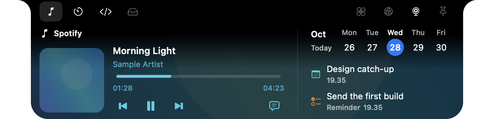
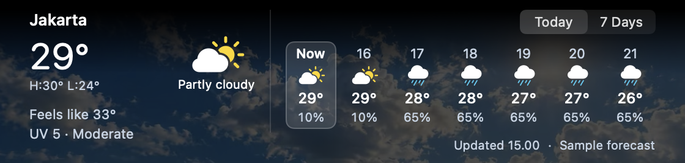
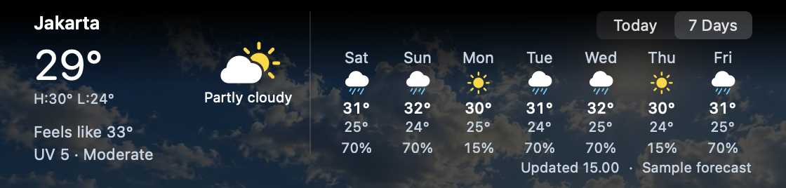

# Mac UI screenshots

Native SwiftUI and AppKit screenshots for **Ordinary Notch 0.18.41 (96)**, captured on October 28, 2026.

Personal content is replaced with sample data before capture. Songs, artwork, tasks, calendar entries, files, clipboard text, weather, and account details are demonstration fixtures. Network addresses use the documentation range, and `alex` is a fictional preview account. The camera remains inactive; no face or real desktop windows were captured. Public app credits remain visible.

All 97 images were visually reviewed and checked with OCR. Images use lossless WebP at their original capture dimensions, with EXIF and XMP omitted. Settings show the initial viewport of each page. About uses the release version and app icon as preview metadata; lock-screen examples use a plain backdrop.

## Main views

## Browse by area

| Area | Captures |
| --- | --- |
| [Notch tabs, lyrics, and notices](notch/README.md) | 14 |
| [Island tabs, lyrics, and notices](island/README.md) | 14 |
| [Weather](weather/README.md) | 2 |
| [Dock and window previews](dock/README.md) | 3 |
| [Clipboard history](clipboard/README.md) | 2 |
| [Lock-screen media and lyrics](lock-screen/README.md) | 3 |
| [Settings](settings/README.md) | 59 |

Settings includes all 22 sidebar pages in light and dark appearances, plus 15 distinct detail pages in dark appearance. The manifest records each image’s dimensions, size, and checksum.

[Image manifest](manifest.json) · [Release 0.18.41](https://github.com/Nucizz/OrdinaryNotch/releases/tag/v0.18.41)
