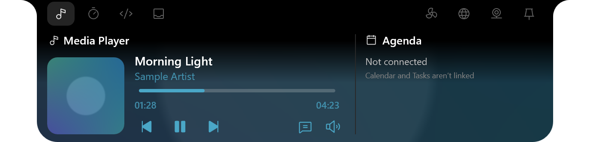
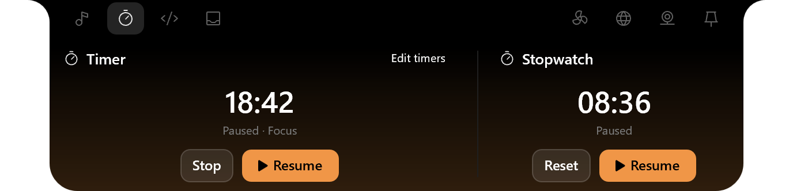
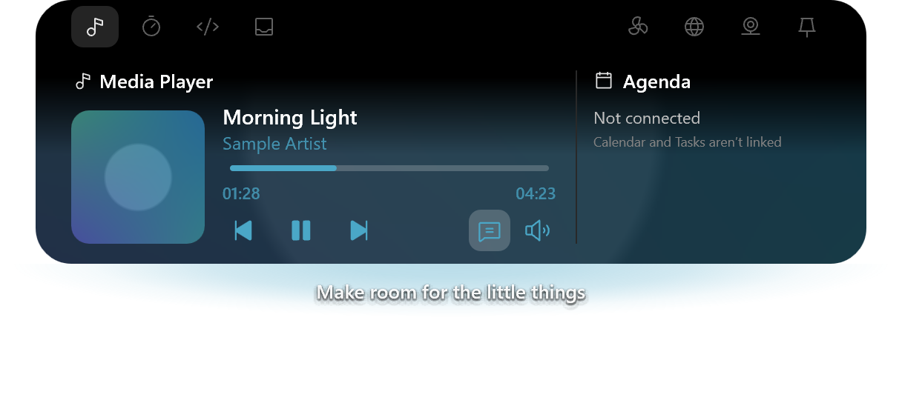

# Windows UI screenshots

Native Win32, Direct2D and DirectComposition screenshots of **Ordinary Notch for Windows**, captured on October 31, 2026. The Windows app is in development and has no public release yet, so these images show work in progress, not a shipped version.

Everything shown is sample content. Songs, artwork, timers, files, clipboard text and performance readings are demonstration data. Notch and Island panels are rendered offscreen from the app's own renderer, then placed on a white canvas to line up with the [Mac gallery](../mac/README.md). Settings and Clipboard are single-window captures from an isolated test run. The camera stays inactive; no face, real desktop or personal content was captured.

Panels are PNG at 2x scale. Settings and Clipboard are PNG at the capture display's 125% scale and show the initial viewport of each page. Metadata is omitted. The sample album-photo brightness is set to the level measured in the Mac captures; the app's default is lower.

## Main views

## Browse by area

| Area | Captures |
| --- | --- |
| [Notch tabs and lyrics](notch/README.md) | 7 |
| [Island tabs and lyrics](island/README.md) | 7 |
| [Clipboard history](clipboard/README.md) | 2 |
| [Settings](settings/README.md) | 16 |

Windows owns several features the Mac app builds itself, so some views differ on purpose: Clipboard reads Windows clipboard history, and Camera opens the Windows Camera app. Fan speed and fan control are unavailable, and the Agenda stays unlinked. All 32 images are listed with their dimensions, sizes and checksums in the [image manifest](manifest.json).
